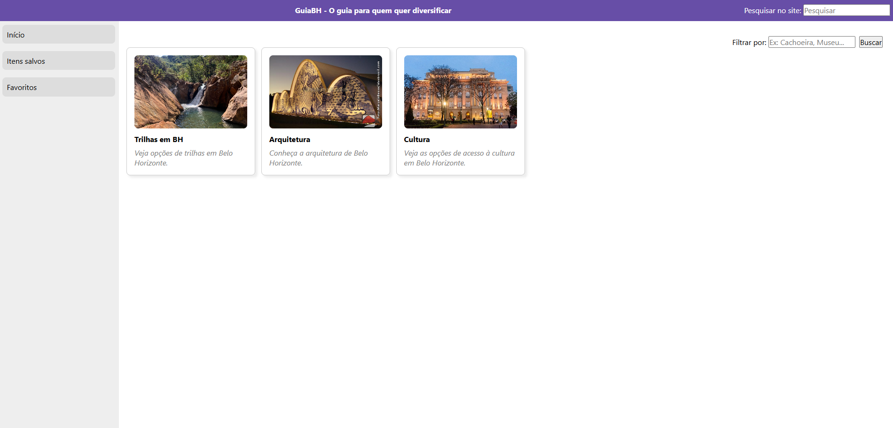

Dados básicos:

NOME: João Paulo Miranda Cardoso

Matrícula: 936517

Proposta de projeto escolhida: 2 (Referente à semana 4)

Breve descrição sobre o projeto: Site de guia de atrações em Belo Horizonte. Tanto para pessoas que moram na cidade e querem diversificar, quanto para quem está visitando a cidade e tem conhecimento sobre as atrações do local.

Resultados:

Home page:

Trilha:

Arquitetura:

Cultura:

Dados JSON:

{
        id: 1,
        titulo: "Trilhas em BH",
        descricao: "Veja opções de trilhas em Belo Horizonte.",
        conteudo: "Belo Horizonte e seu entorno oferecem diversas opções de trilhas com visuais incríveis da Serra do Curral, cachoeiras e vegetação típica do cerrado e mata atlântica. Ideal para quem busca aventura e contato com a natureza.",
        categoria: "Ecoturismo",
        localizacao: "Parque das Mangabeiras / Serra do Curral",
        imagem: "./assets/img/trilha.png"
    },
    {
        id: 2,
        titulo: "Arquitetura",
        descricao: "Conheça a arquitetura de Belo Horizonte.",
        conteudo: "A capital mineira destaca-se pelo Conjunto Arquitetônico da Pampulha, projetado por Oscar Niemeyer e reconhecido como Patrimônio Cultural da Humanidade. Além disso, o centro da cidade abriga belos prédios em estilo Art Déco e Neoclássico.",
        categoria: "Patrimônio & Arquitetura",
        localizacao: "Orla da Lagoa da Pampulha",
        imagem: "./assets/img/igrejaPampulha.png"
    },
    {
        id: 3,
        titulo: "Cultura",
        descricao: "Veja as opções de acesso à cultura em Belo Horizonte.",
        conteudo: "O Circuito Liberdade reúne diversos museus e centros culturais de destaque nacional, como o CCBB BH, o Memorial Minas Gerais Vale e o Museu das Minas e do Metal, oferecendo uma rica programação gratuita de exposições e espetáculos.",
        categoria: "Cultura & Arte",
        localizacao: "Praça da Liberdade - Funcionários",
        imagem: "./assets/img/ccbb.png"
    }